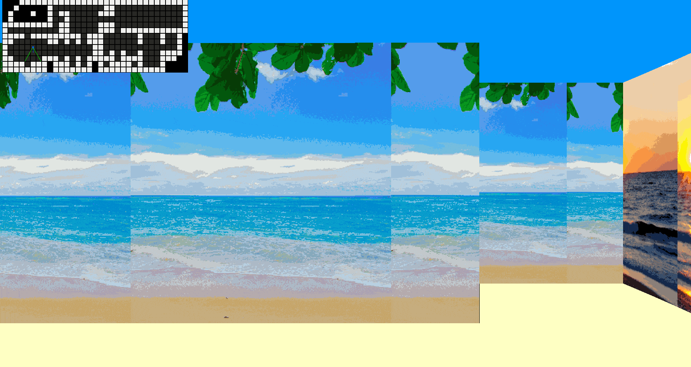

# cub3D

`cub3D` is a final C school project that recreates the core rendering idea behind early first-person games like **Wolfenstein 3D** and **Doom**: turning a simple 2D map into the illusion of a 3D world.

This was a two-person project completed over roughly one month, from November to December 2023. It received a final grade of **105/100**, including some bonus work.



## Project Overview

The program reads a `.cub` map file, loads wall textures and color settings, validates the map, then opens a graphical window where the player can move through the level in first person.

The world is stored as a grid:

- `1` means wall
- `0` means open floor
- `N`, `S`, `E`, or `W` marks the player's starting position and direction
- spaces are allowed outside the playable area

From that simple text map, the engine draws a full-screen first-person view by casting one ray per screen column, measuring where each ray hits a wall, and drawing a vertical textured slice whose height depends on distance.

## What It Does

- Parses `.cub` level files.
- Loads four directional wall textures: north, south, east, and west.
- Reads floor and ceiling RGB colors.
- Validates that maps are enclosed and structurally safe to render.
- Renders a pseudo-3D first-person scene with MiniLibX.
- Applies wall textures based on which side of a wall the player is facing.
- Corrects fisheye distortion so walls do not appear warped.
- Includes a minimap overlay showing the player, map layout, and ray direction.
- Supports keyboard movement and camera rotation.

Two example levels are included:

- `levels/beach/beach_map.cub`
- `levels/jungle/jungle_map.cub`

## Why This Project Is Challenging

For students, `cub3D` is often difficult because it combines low-level C programming with graphics, geometry, parsing, and memory management all at once.

The most important challenge is the **raycasting engine**. The program does not use a 3D library. Instead, it calculates horizontal and vertical grid intersections manually using trigonometry, chooses the nearest wall hit, fixes fisheye distortion, and converts the result into a vertical strip on screen.

Another hard part is **texture mapping**. Once a ray hits a wall, the engine must determine which texture to use and which exact column of that texture should be drawn. The texture then has to be scaled vertically into the wall slice, pixel by pixel, inside a raw MiniLibX image buffer.

Map validation is also more involved than it first appears. A valid level cannot leak into empty space, and irregular maps with padding, spaces, and uneven row lengths must still be handled safely. This implementation includes a perimeter crawl and neighbor checks to reject invalid maps before rendering.

Finally, because this is written in C, every allocation, image, window, and parsed string has to be cleaned up manually. A small mistake in ownership or shutdown handling can cause leaks, crashes, or undefined behavior.

## Build and Run

This project targets Linux and uses:

- `cc`
- `make`
- MiniLibX
- X11 development libraries
- math library `-lm`
- the included `libft` submodule

Build the executable:

```sh
make
```

Run one of the included maps:

```sh
./cub3D levels/jungle/jungle_map.cub
```

or:

```sh
./cub3D levels/beach/beach_map.cub
```

Clean build files:

```sh
make clean
```

Remove build files and the executable:

```sh
make fclean
```

## Controls

In this checkout, the key constants are configured for the `HOME_PC` layout in `includes/keys.h`:

- `Z` / `S`: move forward / backward
- `Q` / `D`: strafe left / right
- Left / right arrows: rotate camera
- `Esc`: quit

The header also contains alternate constants for a `SCHOOL_PC` layout, where movement uses the more typical `W`, `A`, `S`, `D` keys.

## File Format

A map file starts with texture paths and colors:

```text
NO ./levels/jungle/jungle_texture_1.xpm
SO ./levels/jungle/jungle_texture_2.xpm
WE ./levels/jungle/jungle_texture_3.xpm
EA ./levels/jungle/jungle_texture_4.xpm
C 153,255,153
F 0,69,5
```

Then comes the map grid:

```text
111111111111
100000000001
10000N000001
100000000001
111111111111
```

## Implementation Notes

The code is split into focused modules:

- `srcs/map_parsing`: reads and validates `.cub` files
- `srcs/engine/rays`: raycasting and wall projection
- `srcs/engine/image_utils`: MiniLibX image and texture handling
- `srcs/engine/player`: player position, movement, and rotation
- `srcs/engine/engine`: rendering setup, minimap, and main drawing flow
- `srcs/main`: startup, hooks, and shutdown

The result is a compact software renderer: a C program that builds a playable first-person view from a text file, raw textures, and math.
